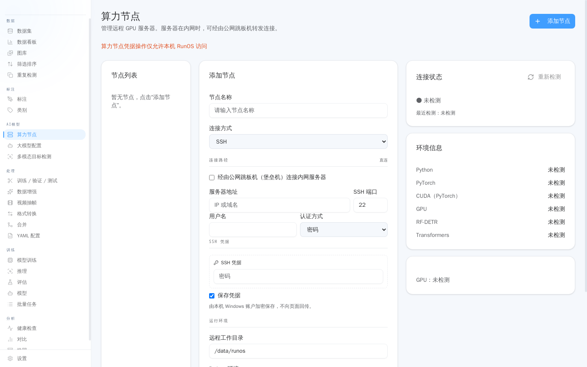
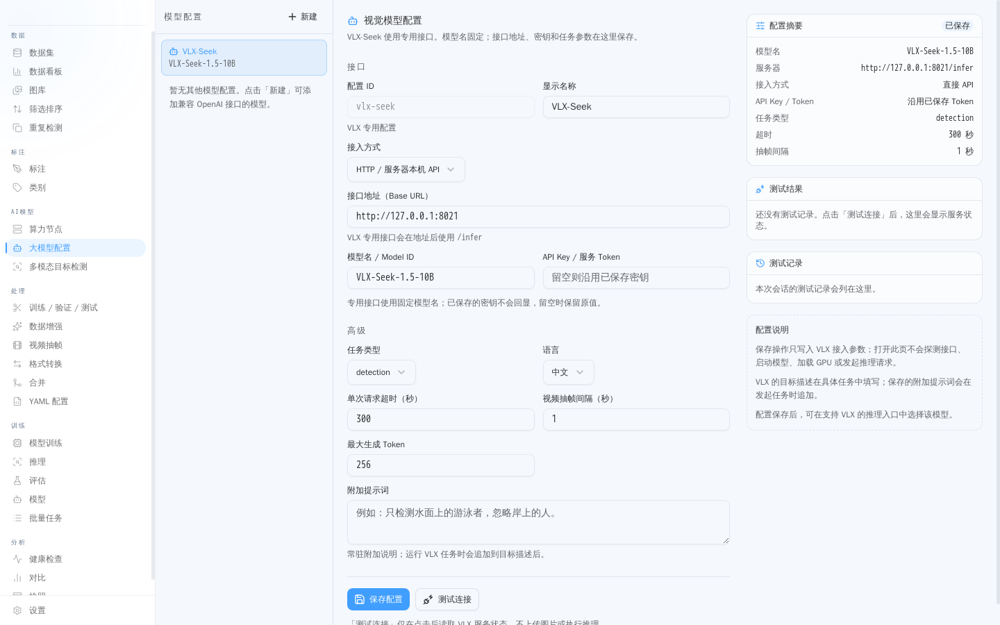
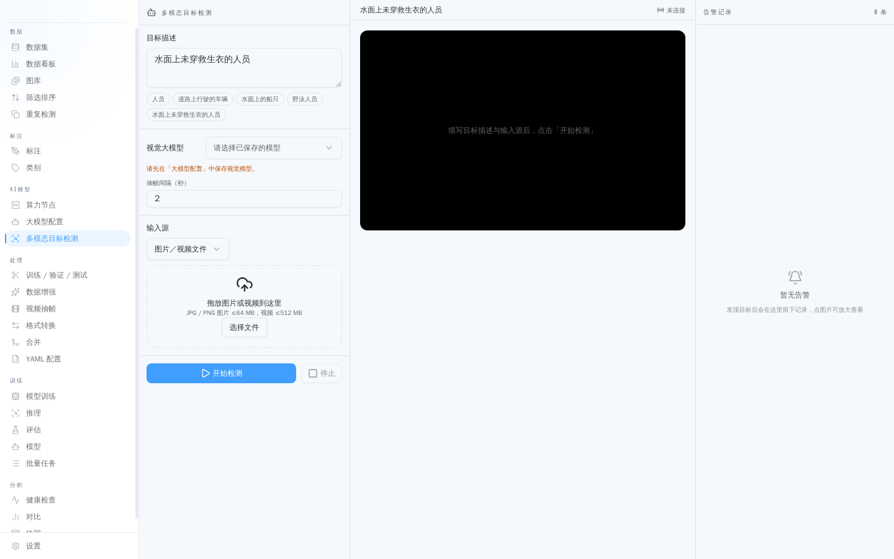
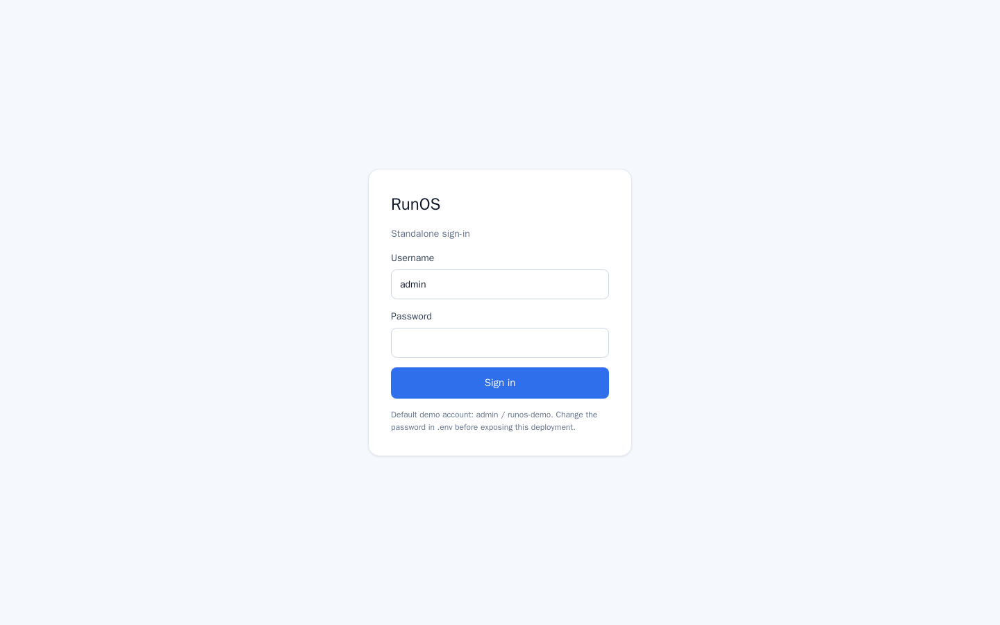
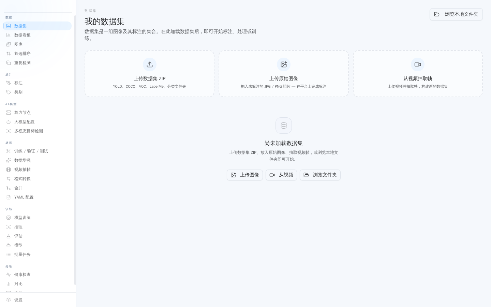

[简体中文](README.md) | English

# RunOS

RunOS is a standalone intelligent data engine for drone and vision data:
dataset management, smart annotation, model training and evaluation,
and compute-node orchestration across servers, all in one self-hosted service.

It evolved from visos: it keeps the visos data and annotation base, adds
real-time multimodal LLM recognition and LLM-powered auto-annotation, and
targets a DJI FlightHub 2-class user experience. Compute nodes let you pool
the GPUs of several servers for training jobs.

## Highlights

### Compute nodes

Register several servers as compute nodes; training, inference, and cloud
LLM workloads run on them:

- Connect over SSH or API. A node carries host, port, username, password or
  key authentication, a workdir, and a Python environment (system / conda /
  venv).
- Adding a node runs detection automatically: connectivity, OS, workdir, and
  GPU list, with errors in the report; first connection asks you to confirm
  the host fingerprint.
- Servers on a private network can be reached through a public jump host
  (local → jump host → private server); the jump host also supports password
  or key authentication.
- Compute-node credentials can only be managed from the local RunOS instance.




### LLM auto-annotation

Let a vision LLM label your data, then review the results before applying
them to the dataset:

- Providers: Qwen-VL (Alibaba Cloud DashScope), OpenAI GPT-4o, local vLLM,
  and local Ollama, all through OpenAI-compatible APIs; plus a dedicated
  VLX-Seek configuration.
- Flow: configure the endpoint and classes → launch an auto-annotation job
  → pause, resume, or stop the job → review each annotation → apply to the
  dataset.
- Job results, logs, and raw outputs are all viewable, replacing pure manual
  annotation at much lower cost.




### LLM detection

Describe the target in natural language and let the model return detection
conclusions directly:

- For example, "find boats on the water": the cloud VLX-Seek detector returns
  conclusions and raises alerts by rule.
- Tasks carry result JSON, result video, snapshots, and alert evidence
  (alert evidence can be recovered and viewed); video tasks, per-frame, and
  single-image inference are also available.
- Local YOLOE model status and VLX-Seek node connectivity are visible in the
  UI, with a clear notice when something is not configured yet.




## Features

- **Dataset management**: import, browse, filter, merge, split, format
  conversion, version snapshots
- **Smart annotation**: manual annotation, AI-assisted annotation, LLM
  auto-annotation (VLM multimodal recognition), human review flow
- **Models and training**: YOLO / RF-DETR training jobs, progress tracking,
  evaluation comparison
- **Compute nodes**: register several servers as compute nodes; training and
  inference jobs are scheduled across nodes
- **Real-time multimodal recognition**: multimodal LLM recognition and alert
  evidence retention for video and image streams
- **Camera and video**: video frame extraction, tile preview, tiling

## Pages tour

Screenshots and descriptions of the sign-in page and every view are in
[docs/pages-tour.en.md](docs/pages-tour.en.md) (taken in an empty-data
environment; pages that need a dataset show a "no dataset selected"
placeholder; Chinese version: [docs/pages-tour.md](docs/pages-tour.md)).






## Quick start

```
cp .env.example .env   # change the demo password first

docker compose up -d --build
```

Open http://127.0.0.1:19000 and sign in with the account in `.env`
(demo account `admin / runos-demo`).

## Architecture

```
frontend/   Next.js frontend (app/, components/, lib/)
backend/    FastAPI backend (app/, uvicorn :8010)
            routers/: annotation, datasets, training, compute nodes,
                     multimodal, inference, evaluation, ...
            compute/: node scheduling and remote jobs
            lmm/, vlm_annotator: multimodal LLM capabilities
```

The frontend talks to the backend through a server-side proxy; the browser
never connects to the backend directly. Data lives in the Docker volume
`runos-data` by default (backend `RUNOS_DATA_ROOT=/data`).

## Sign-in

- **local (default)**: standalone single-admin sign-in. The username and
  password come from `.env` (`RUNOS_ADMIN_USER` / `RUNOS_ADMIN_PASSWORD`).
  Sessions are HMAC-signed tokens; the signing key is generated on first
  start and kept in the data volume (`.session_secret`), so sessions survive
  restarts.

## Configuration

| Variable | Description | Default |
| --- | --- | --- |
| `RUNOS_ADMIN_USER` / `RUNOS_ADMIN_PASSWORD` | Local admin account | `admin` / `runos-demo` |
| `RUNOS_PORT` | Frontend port | `19000` |
| `RUNOS_BIND` | Frontend bind address (loopback by default; set a LAN IP for LAN access) | `127.0.0.1` |
| `RUNOS_DATA_ROOT` | Backend data directory (inside the container) | `/data` |

## Notes and limits

- This repository contains no real secrets, model weights, or business data.
  Model weights download on demand at runtime; LLM recognition needs a model
  service or API key you provide.
- The backend image is large (PyTorch + Ultralytics stack), so the first
  build takes a while. On a GPU machine, swap in a GPU base image to enable
  CUDA.
- Training jobs themselves need compute and model weights; the one-command
  deployment verifies the service chain, not training quality.
- License: MIT, copyright placeholder `RunOS Authors`; the legal entity name
  can be set before a formal release.
