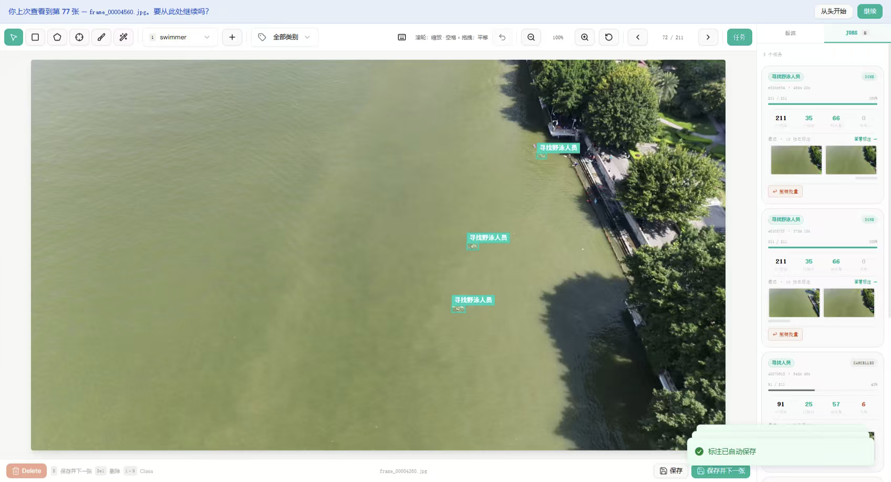

[简体中文](README.md) | English

# RunOS

[](LICENSE)
[](https://github.com/melba818/RunOS-Drone-Platform/stargazers)

**Drone data in, working models out — in one self-hosted service.**


One flight brings back thousands of photos and hours of video. Then what? Data scattered across disks, labels clicked one by one, GPUs idling on other machines, a different tool for every step — the model hasn't started training and the time is already gone.

RunOS cleans up that whole chain: datasets, annotation, training, and inference, all in one standalone service. It grew out of visos, keeping the solid data and annotation base and adding real-time multimodal recognition and LLM auto-annotation.


## Quick start

```bash
cp .env.example .env   # change the demo password first

docker compose up -d --build
```

Open http://127.0.0.1:19000 and sign in with the account in `.env`
(demo account `admin / runos-demo`).

## Why RunOS

- **Data that's ready to use**: import, browse, filter, merge, split, convert formats, snapshot versions — get the dataset in shape before talking about models.
- **No more labeling everything by hand**: manual annotation as the base, AI assistance and LLM auto-annotation on top, human review before anything is applied — let the model do the grinding first pass.
- **Compute wherever your GPUs are**: register every server you have as a compute node; the terminal dispatches jobs, nodes run them, and results come back to the terminal.
- **Detect before you train**: describe the target in one sentence and get conclusions, alerts, and evidence back — no need to label hundreds of images first.
- **One service, not a toolchain**: datasets, annotation, training, and inference in a single self-hosted deployment.

## Highlights

### Compute nodes

One server acts as the terminal (control center) and the rest provide compute: RunOS runs on the terminal and controls everything — training jobs are dispatched from the terminal to compute nodes, and results come back to the terminal when done. No more SSH-ing into each machine:

- Connect over SSH or API. A node carries host, port, username, password or
  key authentication, a workdir, and a Python environment (system / conda /
  venv).
- Adding a node runs detection automatically: connectivity, OS, workdir, and
  GPU list, with errors in the report; first connection asks you to confirm
  the host fingerprint.
- Servers on a private network can be reached through a public jump host
  (local → jump host → private server); the jump host also supports password
  or key authentication.
- Compute-node credentials can only be managed from the local RunOS instance.


### LLM auto-annotation

Let the model do the tedious first pass; humans just check the work:

- Providers: Qwen-VL (Alibaba Cloud DashScope, direct connection in China),
  OpenAI GPT-4o, local vLLM, and local Ollama, all through OpenAI-compatible
  APIs; plus a dedicated VLX-Seek configuration.
- Flow: configure the endpoint and classes → launch an auto-annotation job
  → pause, resume, or stop the job → review each annotation → apply to the
  dataset.
- Job results, logs, and raw outputs are all viewable, replacing pure manual
  annotation at much lower cost.



### LLM detection

Want boats on the water? Don't label hundreds of boats and train a model first — just ask:

- For example, "find boats on the water": the cloud VLX-Seek detector returns
  conclusions and raises alerts by rule.
- Tasks carry result JSON, result video, snapshots, and alert evidence
  (alert evidence can be recovered and viewed); video tasks, per-frame, and
  single-image inference are also available.
- Local YOLOE model status and VLX-Seek node connectivity are visible in the
  UI, with a clear notice when something is not configured yet.


## Features

- **Dataset management**: import, browse, filter, merge, split, format
  conversion, version snapshots
- **Smart annotation**: manual annotation, AI-assisted annotation, LLM
  auto-annotation (VLM multimodal recognition), human review flow
- **Models and training**: YOLO / RF-DETR training jobs, progress tracking,
  evaluation comparison
- **Compute nodes**: register several servers as compute nodes; training and
  inference jobs are scheduled across nodes
- **Real-time multimodal recognition**: multimodal LLM recognition and alert
  evidence retention for video and image streams
- **Camera and video**: video frame extraction, tile preview, tiling

## Pages tour

Screenshots and descriptions of the sign-in page and every view are in
[docs/pages-tour.en.md](docs/pages-tour.en.md) (taken in an empty-data
environment; pages that need a dataset show a "no dataset selected"
placeholder; Chinese version: [docs/pages-tour.md](docs/pages-tour.md)).


## Architecture

```
frontend/   Next.js frontend (app/, components/, lib/)
backend/    FastAPI backend (app/, uvicorn :8010)
            routers/: annotation, datasets, training, compute nodes,
                     multimodal, inference, evaluation, ...
            compute/: node scheduling and remote jobs
            lmm/, vlm_annotator: multimodal LLM capabilities
```

The frontend talks to the backend through a server-side proxy; the browser
never connects to the backend directly. Data lives in the Docker volume
`runos-data` by default (backend `RUNOS_DATA_ROOT=/data`).

## Sign-in

- **local (default)**: standalone single-admin sign-in. The username and
  password come from `.env` (`RUNOS_ADMIN_USER` / `RUNOS_ADMIN_PASSWORD`).
  Sessions are HMAC-signed tokens; the signing key is generated on first
  start and kept in the data volume (`.session_secret`), so sessions survive
  restarts.

## Configuration

| Variable | Description | Default |
| --- | --- | --- |
| `RUNOS_ADMIN_USER` / `RUNOS_ADMIN_PASSWORD` | Local admin account | `admin` / `runos-demo` |
| `RUNOS_PORT` | Frontend port | `19000` |
| `RUNOS_BIND` | Frontend bind address (loopback by default; set a LAN IP for LAN access) | `127.0.0.1` |
| `RUNOS_DATA_ROOT` | Backend data directory (inside the container) | `/data` |

## Notes and limits

- This repository contains no real secrets, model weights, or business data.
  Model weights download on demand at runtime; LLM recognition needs a model
  service or API key you provide.
- The backend image is large (PyTorch + Ultralytics stack), so the first
  build takes a while. On a GPU machine, swap in a GPU base image to enable
  CUDA.
- Training jobs themselves need compute and model weights; the one-command
  deployment verifies the service chain, not training quality.
- License: MIT, copyright RunZe Huang.
